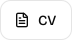

<a href="https://prashanttimilsina.com.np">
  <picture>
    <source media="(prefers-color-scheme: dark)" srcset="assets/hero-dark.svg">
    <source media="(prefers-color-scheme: light)" srcset="assets/hero-light.svg">
    
  </picture>
</a>

  <a href="https://prashanttimilsina.com.np"><picture><source media="(prefers-color-scheme: dark)" srcset="assets/btn-portfolio-dark.svg"><source media="(prefers-color-scheme: light)" srcset="assets/btn-portfolio-light.svg"></picture></a>
  <a href="https://prashanttimilsina.com.np/Prashant_Timilsina_Resume.pdf"><picture><source media="(prefers-color-scheme: dark)" srcset="assets/btn-cv-dark.svg"><source media="(prefers-color-scheme: light)" srcset="assets/btn-cv-light.svg"></picture></a>
  <a href="https://www.linkedin.com/in/prashant-timilsina"><picture><source media="(prefers-color-scheme: dark)" srcset="assets/btn-linkedin-dark.svg"><source media="(prefers-color-scheme: light)" srcset="assets/btn-linkedin-light.svg"></picture></a>
  <a href="https://www.instagram.com/p_ras_hant_"><picture><source media="(prefers-color-scheme: dark)" srcset="assets/btn-instagram-dark.svg"><source media="(prefers-color-scheme: light)" srcset="assets/btn-instagram-light.svg"></picture></a>

<picture>
  <source media="(prefers-color-scheme: dark)" srcset="assets/contributions-dark.svg">
  <source media="(prefers-color-scheme: light)" srcset="assets/contributions-light.svg">
  
</picture>

## Stack

<picture>
  <source media="(prefers-color-scheme: dark)" srcset="assets/stack-dark.svg">
  <source media="(prefers-color-scheme: light)" srcset="assets/stack-light.svg">
  
</picture>

Open to full-stack roles and freelance work · Pokhara, Nepal (UTC+5:45)

